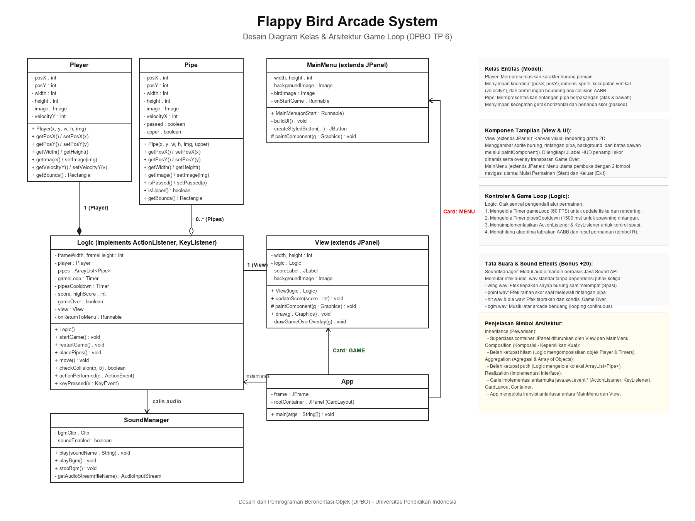
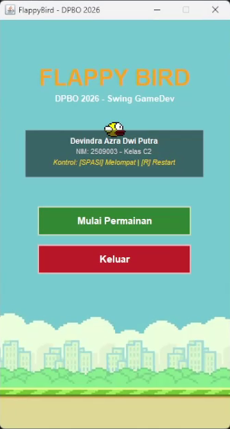
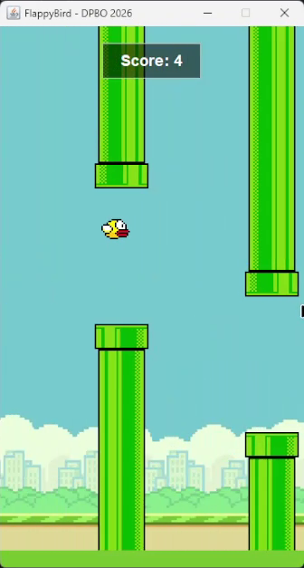
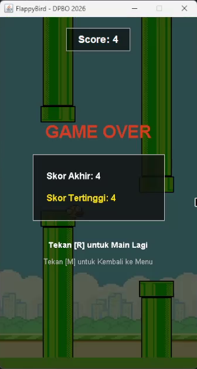

# TP6 DPBO 2025/2026 - Java Swing 2D Game Development: Flappy Bird Arcade (Canvas, Game Loop, Collision, HUD Score, Main Menu, & Audio)

Tugas Praktikum 6 mata kuliah Desain dan Pemrograman Berorientasi Objek (DPBO), Program Studi Ilmu Komputer, Universitas Pendidikan Indonesia, semester genap 2025/2026.

---

## Janji Kejujuran Akademik

Saya Devindra Azra Dwi Putra dengan NIM 2509003 mengerjakan TP 6 dalam mata kuliah DPBO untuk keberkahanNya maka saya tidak melakukan kecurangan seperti yang telah dispesifikasikan. Aamiin.

---

## Deskripsi Singkat

Program ini merupakan implementasi permainan arkade 2D legendaris **Flappy Bird** yang dibangun secara mandiri menggunakan pustaka antarmuka grafis standar **Java Swing murni** (`java.awt.*` dan `javax.swing.*`) tanpa melibatkan framework atau game engine pihak ketiga (seperti LibGDX, Unity, Godot, atau Slick2D).

1. **Kondisi Game Over (Pemain Kalah)**:
   - Permainan otomatis terhenti saat objek burung (`Player`) menabrak/menyentuh salah satu rintangan pipa (`Pipe`), baik pipa atas maupun pipa bawah.
   - Deteksi tabrakan dihitung menggunakan algoritma *Axis-Aligned Bounding Box (AABB) Collision Detection*.
   - Permainan juga otomatis terhenti jika burung terjatuh menyentuh batas bawah jendela (*ground floor boundary*).
   - Saat kalah, seluruh timer (`gameLoop` dan `pipesCooldown`) dihentikan, audio tabrakan diputar, dan layar menampilkan overlay Game Over semi-transparan.
2. **Fitur Mulai Ulang (Restart Game dengan Tombol "R")**:
   - Setelah kondisi Game Over tercapai, pemain dapat mengulang permainan seketika hanya dengan menekan tombol **"R"** (`KeyEvent.VK_R`) pada keyboard.
   - Logika restart mereset koordinat burung ke titik awal, menetralkan kecepatan vertikal (`velocityY = 0`), mengosongkan seluruh pipa yang tersisa di layar (`pipes.clear()`), mereset perolehan skor kembali ke 0, dan menjalankan kembali game loop beserta timer rintangan.
3. **Komponen Skor Berbasis `JLabel`**:
   - Perolehan skor pemain ditampilkan secara dinamis menggunakan komponen Swing `JLabel` pada HUD bagian atas kanvas.
   - Tampilan skor dikemas dalam panel berbentuk kapsul (*score pill*) dengan latar semi-transparan berbingkai kontras tinggi agar teks tetap terbaca jelas di atas animasi awan maupun pipa.
4. **Sistem Penghitungan Skor (+1 Poin Per Rintangan)**:
   - Setiap kali pemain berhasil melintasi celah di antara sepasang pipa tanpa menabrak, skor bertambah tepat $+1$ poin.
   - Pengecekan hanya dihitung satu kali per celah menggunakan penanda boolean `passed` pada entitas pipa atas sehingga skor tidak mengalami penghitungan ganda.
   - Pemain juga dapat melihat rekor skor tertinggi (*High Score*) yang disimpan selama aplikasi berjalan.
5. **Menu Utama (Main Menu Awal Program)**:
   - Sebelum permainan dimulai, aplikasi menampilkan panel menu utama yang dilengkapi dengan 2 tombol utama:
     - **Mulai Permainan (Start Game)**: Berpindah dari menu ke arena kanvas permainan dan memulai jalannya game loop.
     - **Keluar (Exit)**: Menutup seluruh proses aplikasi desktop (`System.exit(0)`).
   - Perpindahan antar panel antarmuka dikelola secara mulus menggunakan manajer tata letak `CardLayout` pada satu jendela `JFrame`.
6. **Peluang Nilai Bonus (+20 Poin Audio & Sound Effects)**:
   - Mengintegrasikan modul tata suara mandiri [SoundManager.java](file:///c:/Users/HYPE%20AMD/Code%20File/Kuliah/DPBO/TP/TP6DPBO2526C2/FlappyBird/SoundManager.java) berbasis pustaka resmi **Java Sound API** (`javax.sound.sampled.*`).
   - Memutar efek audio `.wav` sintetis 8-bit tanpa dependensi pustaka luar:
     - `wing.wav`: Efek kepakan sayap burung saat pemain menekan tombol spasi.
     - `point.wav`: Efek denting koin saat pemain berhasil melewati rintangan pipa.
     - `hit.wav`: Efek benturan fisik saat burung menabrak pipa atau tanah.
     - `die.wav`: Efek suara kekalahan saat burung terjatuh.
     - `bgm.wav`: Musik latar bergaya *chiptune arcade* yang berputar secara berkesinambungan (*looping*).

---

## Desain Program & Arsitektur Kelas

### 1. Diagram Kelas Visual (Visual Class Diagram)

Berikut rancangan arsitektur kelas berorientasi objek yang dibangun untuk sistem permainan Flappy Bird:



---

### 3. Deskripsi & Tanggung Jawab Kelas

| Nama Kelas | Peran Arsitektur | Deskripsi & Tanggung Jawab Utama |
| :--- | :--- | :--- |
| **`Player`** | **Model (Entitas)** | Mengenkapsulasi data fisik karakter burung pemain: koordinat $(X, Y)$, ukuran rendering $(34 \times 24\text{ px})$, citra sprite `bird.png`, kecepatan jatuh vertikal (`velocityY`), dan method `getBounds()` untuk batas geometri tabrakan. |
| **`Pipe`** | **Model (Entitas)** | Mengenkapsulasi data rintangan pipa: koordinat $(X, Y)$, dimensi rendering $(64 \times 512\text{ px})$, citra sprite pipa (`upperPipe.png` / `lowerPipe.png`), kecepatan pergerakan horizontal (`velocityX = -2`), serta flag boolean `passed` dan `upper`. |
| **`View`** | **View (Kanvas UI)** | Turunan dari `JPanel` yang bertindak sebagai kanvas visual utama. Mengimplementasikan `paintComponent()` dan `draw()` untuk merender latar belakang, pipa, burung, HUD komponen `JLabel` skor, serta overlay gelap saat Game Over. |
| **`MainMenu`** | **View (Menu Pembuka)**| Turunan dari `JPanel` yang menyajikan tampilan pembuka permainan. Memuat kartu identitas mahasiswa, judul arkade, serta 2 tombol navigasi utama: *"Mulai Permainan"* dan *"Keluar"*. |
| **`Logic`** | **Controller / Engine** | Pusat kendali logika permainan (*Game Engine*). Mengatur timer game loop 60 FPS, timer kemunculan rintangan (1.5 detik), simulasi percepatan gravitasi, deteksi tabrakan AABB, perhitungan skor, serta penanganan event keyboard spasi (lompat) dan tombol "R" (restart). |
| **`SoundManager`**| **Utilitas Audio** | Mengelola pemutaran efek suara arcade (`wing`, `point`, `hit`, `die`) dan musik pengiring latar belakang (`bgm`) menggunakan Java Sound API (`javax.sound.sampled.*`) dengan penanganan eksepsi non-blocking. |
| **`App`** | **Entry Point** | Titik awal eksekusi program (`main`). Menginisialisasi `JFrame` berdimensi $360 \times 640\text{ px}$, menghubungkan `Logic` dan `View`, serta mengatur transisi antarmuka kartu menggunakan `CardLayout`. |

---

## Panduan Kontrol Permainan

| Tombol / Aksi | Kondisi / Layar | Efek & Tindakan |
| :--- | :--- | :--- |
| **Klik Tombol "Mulai Permainan"** | Layar Menu Utama | Membuka arena permainan dan memulai game loop Flappy Bird. |
| **Klik Tombol "Keluar"** | Layar Menu Utama | Menutup aplikasi secara aman (`System.exit(0)`). |
| **Tombol `[SPASI]`** | Saat Bermain (Active) | Burung mengepakkan sayap dan melompat ke atas (`velocityY = -9`). |
| **Tombol `[R]`** | Layar Game Over | Mengulang kembali permainan dari awal (*Restart Game*). |
| **Tombol `[M]`** | Layar Game Over | Kembali ke Menu Utama (*Return to Main Menu*). |

---

## Struktur Berkas Repositori

```text
TP6DPBO2526C2/
├── FlappyBird/
│   ├── assets/
│   │   ├── background.png      # Gambar latar belakang langit & awan
│   │   ├── bird.png            # Sprite burung kuning Flappy Bird
│   │   ├── upperPipe.png       # Sprite rintangan pipa atas
│   │   ├── lowerPipe.png       # Sprite rintangan pipa bawah
│   │   ├── wing.wav            # Efek suara lompat sayap (8-bit)
│   │   ├── point.wav           # Efek suara perolehan skor koin
│   │   ├── hit.wav             # Efek suara tabrakan rintangan
│   │   ├── die.wav             # Efek suara kekalahan/jatuh
│   │   └── bgm.wav             # Musik latar arkade chiptune (looping)
│   ├── App.java                # Main entry point & manajer CardLayout
│   ├── MainMenu.java           # Panel antarmuka menu pembuka (2 tombol)
│   ├── Player.java             # Entitas burung pemain
│   ├── Pipe.java               # Entitas rintangan pipa berpasangan
│   ├── View.java               # Kanvas grafis JPanel & HUD JLabel skor
│   ├── Logic.java              # Controller game loop, fisika, & key listener
│   └── SoundManager.java       # Modul audio Java Sound API mandiri
├── Dokumentasi/
│   ├── demo.mp4                # Berkas video rekaman demonstrasi program berjalan
│   ├── desain_diagram_tp6.png  # Diagram arsitektur kelas visual resolusi tinggi
│   ├── screenshot_main_menu.png # Tangkapan layar panel Menu Utama
│   ├── screenshot_gameplay.png  # Tangkapan layar arena permainan & HUD skor
│   └── screenshot_game_over.png # Tangkapan layar kondisi Game Over & skor akhir
├── .gitignore                  # Mengabaikan file biner .class dan ide
└── README.md                   # Dokumentasi lengkap proyek tugas praktikum
```

---

## Dokumentasi Output Permainan

Bagian ini menyajikan dokumentasi visual hasil eksekusi program serta rekaman video demonstrasi yang memperlihatkan antarmuka menu pembuka, mekanisme permainan, HUD skor realtime, dan penanganan kondisi Game Over.

### 1. Tampilan Menu Utama (Main Menu)
Antarmuka pembuka sebelum memulai permainan. Menampilkan judul arkade, kartu identitas mahasiswa (*Devindra Azra Dwi Putra - NIM: 2509003*), instruksi kontrol dasar, tombol **"Mulai Permainan"**, dan tombol **"Keluar"**.



### 2. Tampilan Arena Permainan & HUD Skor (`JLabel`)
Arena permainan aktif berbasis kanvas `JPanel` berdimensi $360 \times 640\text{ px}$. Menampilkan animasi pergerakan rintangan pipa hijau, simulasi gravitasi dan lompatan burung, serta komponen HUD `JLabel` perolehan skor pemain di bagian atas.



### 3. Tampilan Kondisi Game Over & Rekor Skor Tertinggi
Kondisi saat burung menabrak pipa atau menyentuh lantai. Game loop otomatis dihentikan, efek suara benturan dan kekalahan diputar, serta ditampilkan kotak dialog skor akhir, rekor skor tertinggi (*High Score*), instruksi tombol `[R]` untuk mengulang permainan, dan tombol `[M]` untuk kembali ke Menu Utama.



### 4. Video Demonstrasi Eksekusi Program
Rekaman video demonstrasi eksekusi program dari tahap inisialisasi hingga penutupan aplikasi:

- **Berkas Video Rekaman**: [demo.mp4](Dokumentasi/demo.mp4)
- **Ringkasan Alur Demonstrasi Video (`demo.mp4`)**:
  1. **Detik 00:00 - 00:10**: Peninjauan struktur proyek dan berkas kode sumber di IDE.
  2. **Detik 00:10 - 00:14**: Program dieksekusi, menampilkan jendela Menu Utama berdimensi $360 \times 640\text{ px}$.
  3. **Detik 00:14**: Pengguna mengklik tombol **"Mulai Permainan"**, jendela beralih ke kanvas arena permainan via `CardLayout`, dan musik latar arkade (*BGM*) berputar.
  4. **Detik 00:15 - 00:23**: Pengguna mengendalikan burung menggunakan tombol spasi melewati rintangan pipa hingga memperoleh skor 4 (efek audio koin berbunyi di setiap celah pipa).
  5. **Detik 00:23 - 00:24**: Burung menyentuh pipa rintangan, memicu penghentian timer, pemutaran suara tabrakan, dan kemunculan overlay *Game Over*.
  6. **Detik 00:25 - 00:26**: Pengguna menekan tombol `[M]` untuk kembali ke panel Menu Utama.
  7. **Detik 00:27**: Pengguna mengklik tombol **"Keluar"**, mengakhiri seluruh proses aplikasi desktop secara bersih.
